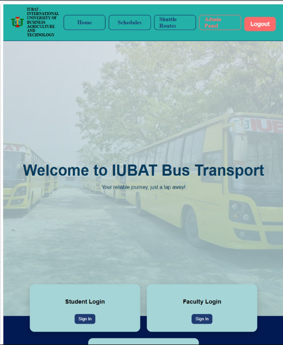
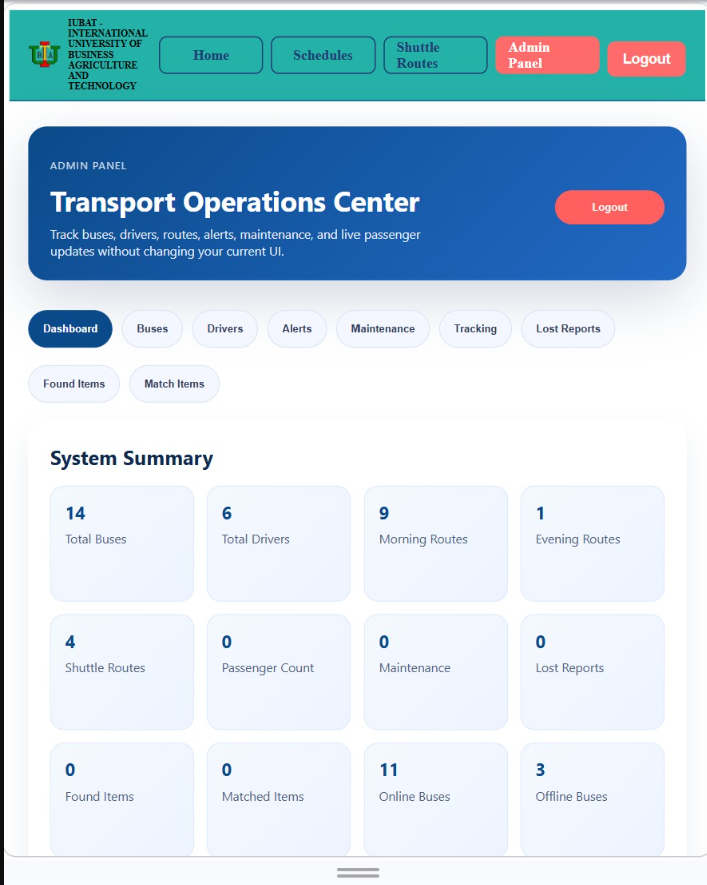
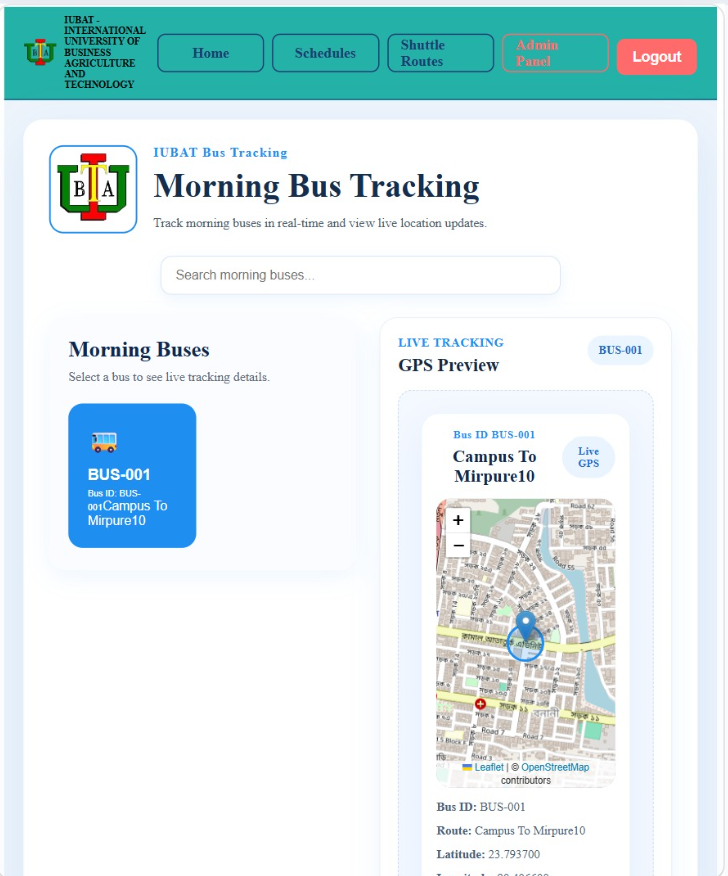
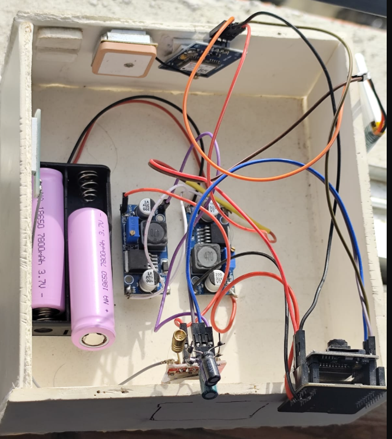
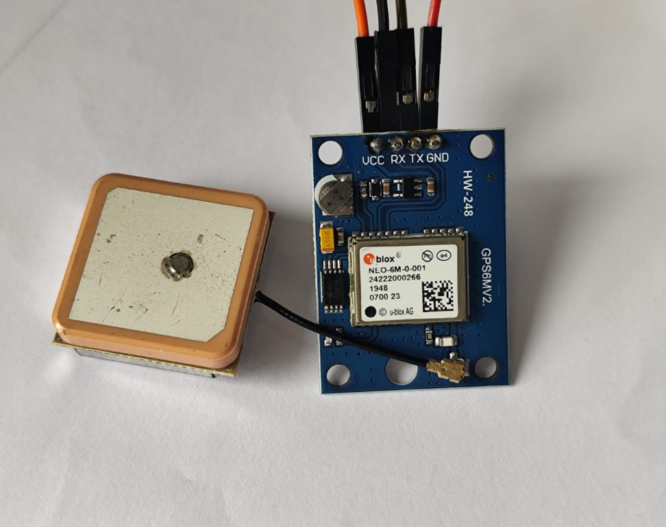
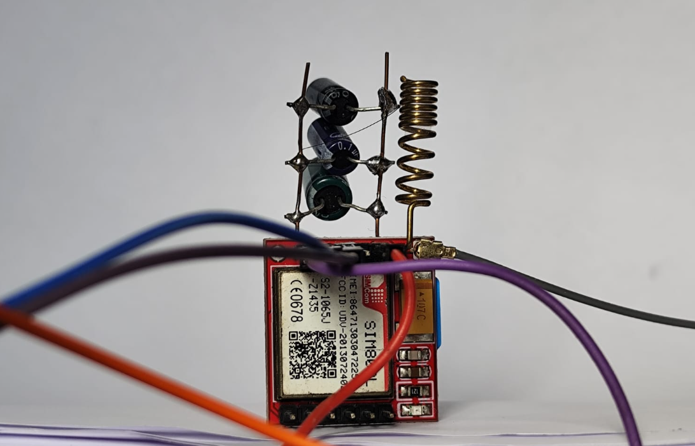
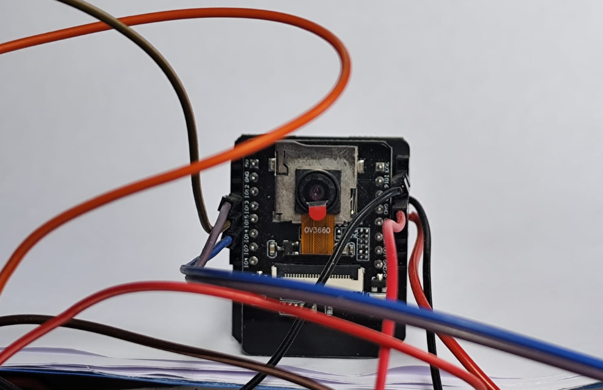

# 🚌 Smart IUBAT Bus Tracking & Passenger Monitoring System

An IoT-based smart university transportation system that combines real-time GPS tracking, AI-powered passenger detection, and a web-based bus management platform.

## 📌 Project Overview

The **Smart IUBAT Bus Tracking & Passenger Monitoring System** aims to make university transportation more convenient by allowing students and faculty to check bus locations and passenger counts before choosing a bus.

The system integrates IoT hardware, GPS technology, computer vision, and a MERN stack web application to provide useful transportation information.

## ✨ Key Features

- 📍 Real-time GPS-based bus tracking.
- 👨‍🎓 Separate Student and Faculty panels.
- 🔐 University ID-based access for students and faculty.
- 🛠️ Dedicated Admin login.
- 🚌 Bus information management.
- 📷 ESP32-CAM-based passenger image capture.
- 📡 SIM800L mobile internet connectivity.
- 📶 Wi-Fi as an alternative image transmission method.
- 🤖 YOLO-based passenger detection using Python.
- 📊 Passenger count display on the website.

## 🏗️ Technologies Used

| Category | Technologies |
|---|---|
| Frontend | React.js |
| Backend | Node.js, Express.js |
| Database | MongoDB |
| AI & Computer Vision | Python, YOLO |
| Hardware Controller | ESP32-CAM |
| GPS Module | NEO-6M |
| Communication | SIM800L, Wi-Fi |
| Mobile Network | Grameenphone SIM / GPRS |

## 🔌 Hardware Components

- **ESP32-CAM:** Captures images of passengers inside the bus.
- **NEO-6M GPS:** Retrieves geographical coordinates for bus tracking.
- **SIM800L GSM/GPRS Module:** Provides mobile internet connectivity using a Grameenphone SIM.
- **Wi-Fi:** Serves as an alternative connection for image transmission when SIM800L connectivity is unavailable or unsuccessful.

The system uses a single ESP32-CAM board connected to the GPS and communication modules.

## 🔄 How It Works

1. The NEO-6M GPS module retrieves the bus's geographical coordinates.
2. The ESP32-CAM captures images of passengers inside the bus.
3. Images are transmitted through SIM800L mobile internet connectivity.
4. If SIM800L connectivity is unavailable or image transmission fails, Wi-Fi is used as an alternative.
5. The backend receives the uploaded images.
6. A separate Python service processes the images using YOLO.
7. YOLO detects people and calculates the passenger count.
8. Bus location and passenger information are displayed on the web application.

## 👥 User Panels

### 🎓 Student Panel

- Access the system using a university ID.
- View available buses.
- Check live bus locations.
- View passenger counts before choosing a bus.

### 👨‍🏫 Faculty Panel

- Access the system using a university ID.
- View bus information.
- Track bus locations.
- Check passenger counts.

### 🛠️ Admin Panel

- Dedicated administrator login.
- Manage and update bus information.
- Maintain transportation data.

## 📸 Software Screenshots

### 1. Homepage and Login

### 2. Admin Dashboard

### 3. Live GPS Tracking

## 🔩 Hardware Setup

The following images show the hardware components used in the project.

### 1. Complete Hardware Setup

### 2. NEO-6M GPS Module

### 3. SIM800L GSM/GPRS Module

### 4. ESP32-CAM Module

## 🚀 Future Improvements

- Improve passenger detection accuracy.
- Implement estimated bus arrival times.
- Add historical passenger statistics.
- Improve connectivity and image transmission reliability.
- Introduce advanced transportation analytics.

## 🎯 Project Goal

To make university transportation smarter, more transparent, and more convenient by combining IoT, GPS tracking, artificial intelligence, and web technologies.

## 👨‍💻 Project Information

- **Project Name:** Smart IUBAT Bus Tracking & Passenger Monitoring System
- **Institution:** International University of Business Agriculture and Technology (IUBAT)
- **Location:** Dhaka, Bangladesh

---

⭐ If you find this project interesting, feel free to explore the repository!
